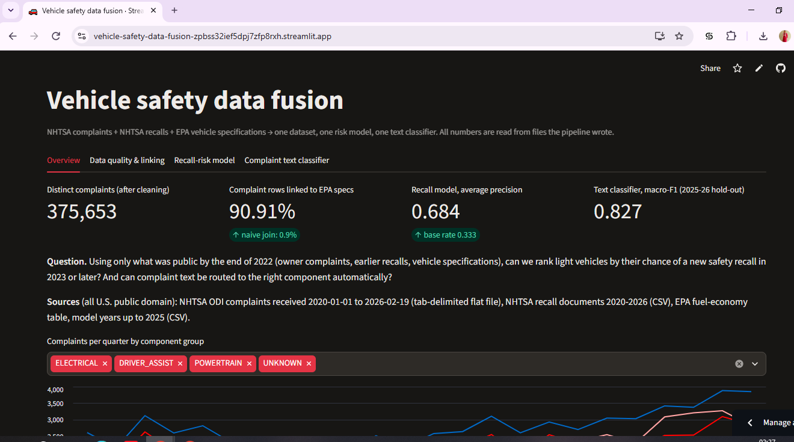
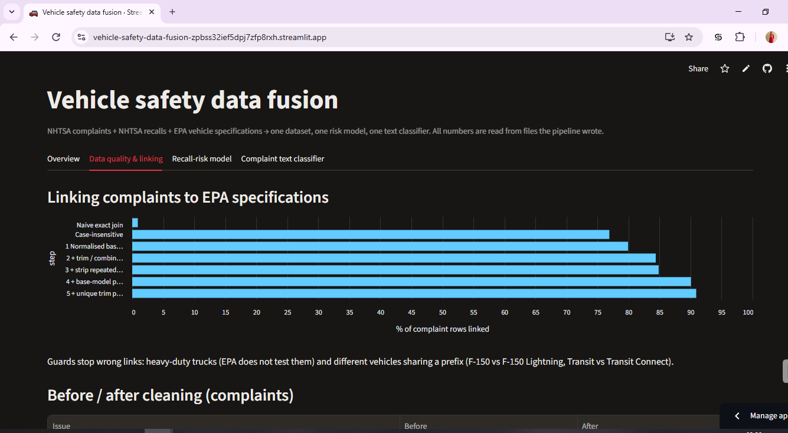
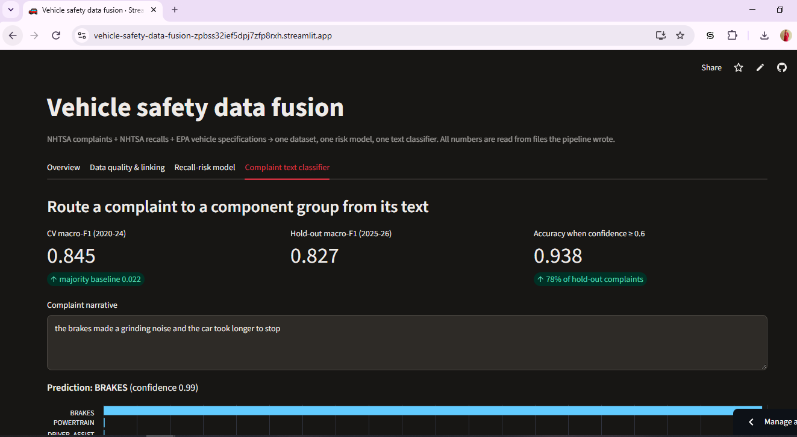

# Vehicle safety data fusion: complaints + recalls + specifications
     **🚀 Live demo: [open the app](https://vehicle-safety-data-fusion-zpbss32ief5dpj7zfp8rxh.streamlit.app/)**
        
        
        

This project assesses three public automotive data sources for AI use, measures and fixes their quality
problems, links them into one dataset, and turns that into two working prototypes:

1. a **recall-risk model** that ranks light vehicles by their chance of a new safety recall, and
2. a **complaint text classifier** that routes owner complaints to a vehicle component.

Everything is shown in a small Streamlit app. Every number in the data-quality report is written by the
pipeline itself, so the report cannot contain a figure that was not measured.

## The problem

US owners file safety complaints with NHTSA, and manufacturers file safety recalls. A reviewer would like to
know which vehicles deserve attention *before* a recall happens. The complaint file barely describes the vehicle,
though: drive train, fuel type and cylinders are blank in about 95% of rows. Vehicle specifications live in a
separate EPA table that shares no ID with NHTSA.

**Questions.**
(1) Using only what was public by 31 Dec 2022, can we rank vehicles by their chance of a recall filed in 2023 or later,
and does adding EPA specifications actually help?
(2) Can a complaint's free text predict which component it concerns?

## Data sources

| Source | Format | Coverage | Licence |
|---|---|---|---|
| NHTSA ODI complaints (`COMPLAINTS_RECEIVED_2020-2024.zip`, `..._2025-2026.zip`) | headerless TAB-delimited text, UTF-8; column names from the NHTSA data dictionary `CMPL.txt` | 545,345 rows received 2020-01-01 to 2026-02-19 | U.S. public domain (data.gov licence: `usa.gov/publicdomain/label/1.0`) |
| NHTSA recall documents (`RCL_FROM_2020_2024.zip`, `..._2025_2026.zip`) | quoted CSV with header | 220,999 rows, 3,814 campaigns filed 2020-2025 | U.S. public domain (data.gov: `us-pd`) |
| EPA fuel-economy vehicle table (`vehicles.csv`) | wide CSV, 84 columns | 48,351 configurations, model years 1984-2025 | EPA data is public domain by default (17 U.S.C. § 105) |

**Provenance note.** The raw files used for the reported results were taken from public GitHub mirrors of the official NHTSA and EPA download (see `src/00_download.py`). The NHTSA files keep their original file names and match the SHA-256 checksums recorded by the mirror, which shows they were not altered after being saved there. It does not by itself prove they are identical to NHTSA's current files. The hashes of all files used are pinned in `src/common.py`, and `01_ingest.py` warns if a file differs, so every number in this repository is reproducible. Official sources: https://www.nhtsa.gov/nhtsa-datasets-and-apis and https://www.fueleconomy.gov/feg/download.shtml (newer files will give slightly different numbers).

## How to run

```bash
pip install -r requirements.txt
./run_all.sh                        # download -> ingest -> clean/link -> model -> NLP -> report -> app assets
streamlit run app/streamlit_app.py  # the app only needs app/assets/, which is committed
```

| Step | File | Output |
|---|---|---|
| 0 | `src/00_download.py` | raw files, hash-checked |
| 1 | `src/01_ingest.py` | parsed parquet, unchanged |
| 2 | `src/02_clean_integrate.py` | cleaned tables, NHTSA→EPA links, `reports/dq_metrics.json` |
| 3 | `src/03_build_vehicle_table.py` | vehicle-level modelling table |
| 4 | `src/04_recall_model.py` | `reports/recall_model_metrics.json`, out-of-fold scores |
| 5 | `src/05_text_classifier.py` | `reports/text_model_metrics.json`, saved model |
| 6 | `src/06_write_dq_report.py` | `reports/DATA_QUALITY.md` |
| 7 | `src/07_export_app_assets.py` | `app/assets/` |

## Findings

### Data quality and integration (full detail: [`reports/DATA_QUALITY.md`](reports/DATA_QUALITY.md))

* **The three sources join only on text, and the text disagrees.** A naive exact join of (make, model, year) links
  **0.9%** of complaint rows to EPA specifications. Normalising names and adding four matching rules raises this to
  **90.9%**. Spot checks of the fuzzy rules found real false links (a petrol F-150 linked to the electric F-150 Lightning,
  heavy-duty Silverado 2500 to the light-duty Silverado, Transit to Transit Connect), so two guards now block them.
* **Rows are not complaints.** 545,345 rows hold 377,469 complaints, because a complaint naming several components
  repeats. Counting rows would inflate statistics by 1.44x.
* **Fixed:** 356 resubmitted complaints (same vehicle, same text, new ID), 414 model names with a data-entry prefix
  ("redundant SIENNA"), 398 → 391 make spellings, 52 component labels from two NHTSA taxonomies → 17 groups,
  impossible failure dates and mileages, 3,427 exact duplicate recall rows, and a text-encoding bug in my first
  version (reading UTF-8 as Latin-1) that garbled characters like "…" in about 49,000 narratives.
* **Structural gaps, not errors:** blank turbo and alternative-fuel flags in EPA mean "no", and missing cylinders are
  almost all electric vehicles (1,046 of 1,085). Both are encoded rather than imputed.

### Recall-risk model

2,487 vehicles (make × base model × model year 2015-2022); 33.3% had a new recall filed in 2023 or later.
Features come from complaints received 2020-2022, recalls filed 2020-2022 and EPA specifications. The hard date cut
keeps label information out of the features. Validation is 5-fold cross-validation **grouped by nameplate**, so no
vehicle's model years sit in both train and test, repeated over 3 seeds (15 folds). The metric is **average precision
(AP)**, which suits ranking a minority class.

| Model | AP (mean ± sd) | ROC-AUC | Precision in top 10% |
|---|---|---|---|
| Baseline: predict base rate | 0.333 ± 0.001 | 0.500 | 0.332 |
| Baseline: complaint count only | 0.475 ± 0.050 | 0.677 | 0.509 |
| Baseline: complaint count + prior recalls | 0.621 ± 0.043 | 0.750 | 0.758 |
| Logistic regression: complaint features | 0.576 ± 0.042 | 0.721 | 0.703 |
| ... + vehicle age | 0.627 ± 0.044 | 0.753 | 0.783 |
| ... + EPA specifications | 0.670 ± 0.043 | 0.777 | 0.828 |
| **... + prior recalls (final model)** | **0.684 ± 0.037** | **0.787** | **0.853** |
| Gradient boosting, same features | 0.677 ± 0.038 | 0.792 | 0.820 |

* **Linking the EPA data pays off.** Because all runs share the same 15 folds, they can be compared fold by fold.
  EPA specifications add +0.043 AP *on top of* vehicle age, and improve every one of the 15 folds. The final model
  beats the strongest simple baseline by +0.063 AP, also in 15/15 folds.
* Strongest signals (permutation importance): prior recalls, complaint volume, vehicle age (newer models are recalled
  more), number of EPA configurations (a rough proxy for model range and sales), and share of electric configurations.
* Gradient boosting was no better than logistic regression, so the simpler, explainable model is the final one.

### Complaint text classifier (NLP)

TF-IDF (word 1-2-grams) + logistic regression predicts 15 component groups from the narrative. It is trained on
60,000 single-component complaints from 2020-2024 and tested once on 15,000 complaints from 2025-2026 that it never saw.
The metric is macro-F1, so every component counts equally.

| | macro-F1 |
|---|---|
| Majority class (CV) | 0.022 |
| Random by class frequency (CV) | 0.067 |
| TF-IDF + logistic regression (5-fold CV, 2020-24) | 0.845 ± 0.004 |
| TF-IDF + logistic regression (hold-out, 2025-26) | **0.827** (accuracy 0.862) |

* When the model's confidence is ≥ 0.6, which applies to 78% of hold-out complaints, it is right **93.8%** of the
  time. Below that, it is right 58.8% of the time. This makes a natural split between auto-routing and manual review.
* Weakest class: speed control (F1 0.401, the smallest class). The most common confusions are engine ↔ powertrain,
  which overlap in how owners describe them.
* Applied to the 27,780 single-component complaints filed as "UNKNOWN OR OTHER", it suggests a component with
  confidence ≥ 0.6 for 14,375 of them (51.7%).

## Limits

* **Complaints are unverified signals.** Volume also depends on sales, which are not public; EPA configuration count is
  only a weak proxy. A risk score is a ranking aid for human review, not evidence of a defect.
* **Scope is US light vehicles.** EPA does not test heavy-duty pickups and vans, RVs or motorcycles, so these cannot
  be linked. The EPA snapshot ends with a partial model year 2025.
* **The label may be incomplete.** The 2025 recall documents contain 210 campaigns, against 563-723 in earlier years,
  probably because documents lag behind filings.
* **Fuzzy links are approximate.** For example, "Santa Fe Sport" gets the specifications of "Santa Fe".
* **One time split only.** The recall model was validated on the 2022 → 2023+ split. A rolling-origin evaluation
  (e.g. 2021 → 2022) would show whether it is stable over time.
* **Unknown-complaint suggestions are unmeasured.** Those complaints have no true label, and their accuracy is likely
  lower than on the labelled hold-out.
* **Multi-component complaints were left out of the NLP task.** 107,380 complaints name more than one component;
  a multi-label model would cover them.

## Repository layout

```
src/        pipeline steps 00-07 plus common.py (normalisation, component mapping) and schema.py
app/        streamlit_app.py and assets/ (small files the app reads)
reports/    DATA_QUALITY.md and the JSON metrics behind every number
data/       raw/, interim/, processed/ (not committed; rebuilt by run_all.sh)
```
